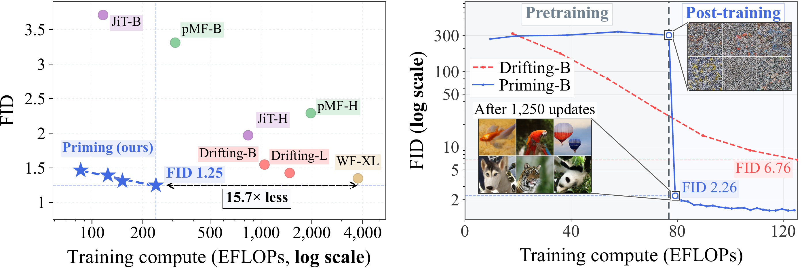
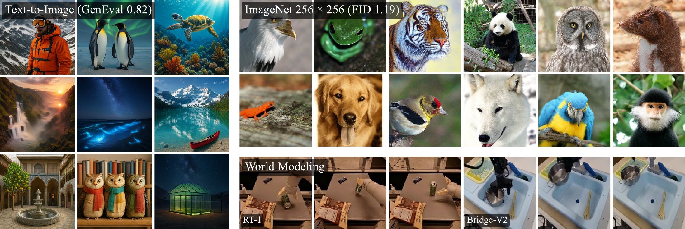
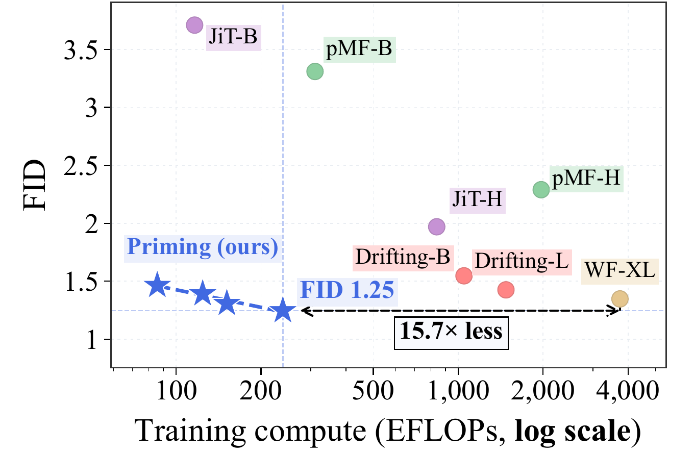
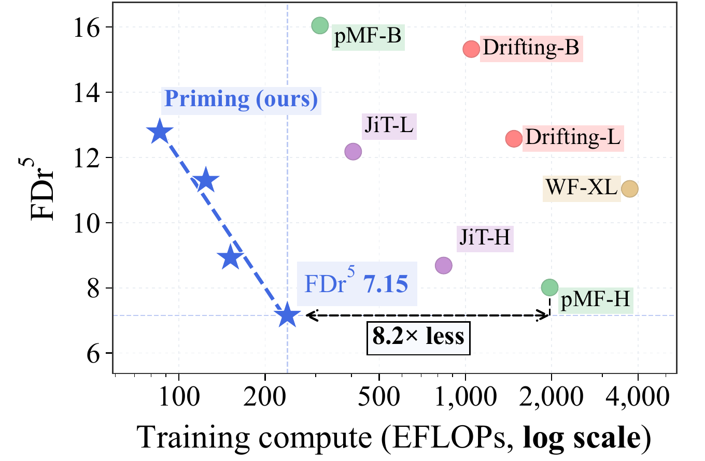

<div align="center">

<h1>Are We Overthinking One-Step Generation?</h1>
<h2>Priming Models</h2>

<p><strong>Woobin Park<sup>1,*</sup>, Jaeyeon Kim<sup>2,*</sup>, Yilun Du<sup>2</sup>, Sitan Chen<sup>2</sup>, Bohyung Han<sup>1</sup></strong></p>

<p><sup>1</sup> Seoul National University &nbsp;·&nbsp; <sup>2</sup> Harvard University<br>
<sup>*</sup> Equal contribution (co-first authors)</p>

<!-- Replace the placeholder href values with the paper and announcement URLs when available. -->
<p id="paper-links">
  <a href="#paper-links" title="arXiv preprint coming soon"></a>
  <a href="#paper-links" title="X announcement coming soon"></a>
</p>

</div>

Official implementation of [Are We Overthinking One-Step Generation?](#paper-links) (arXiv coming soon).

[](docs/figures/figure1.pdf)

## Getting started

Clone this repository as `Priming`; all commands and relative paths below start
there.
For limited home-directory quotas, use the [external-storage setup](docs/setup.md#keep-large-files-outside-home)
to place the environment, downloads, and outputs on a larger disk.

```bash
git clone https://github.com/JaeyeonKim01/one_step_priming.git Priming
cd Priming
bash scripts/create_env.sh
conda activate priming
export PYTHONNOUSERSITE=1
python scripts/check_environment.py
```

- [Environment setup](docs/setup.md): create `priming` and configure CUDA/GPU execution.
- [Data and model assets](docs/assets.md): ImageNet training data and evaluation encoders/statistics; sampling needs only a checkpoint.
- [Checkpoint downloads](docs/checkpoints.md): download and verify the pretrained and post-trained models.
- [Pipeline validation](docs/validation.md): tested H200 startup checks, bounded commands, and scope.

## Checkpoints

Four model/epoch combinations, each available before and after post-training.
Epochs refer to reconstruction pretraining; post-training adds 25,000 OT updates.

| Model | Pretraining epochs | Pretrained | Post-trained |
|---|---:|---|---|
| Priming-B | 80 | [View checkpoint](https://huggingface.co/jaykim1102/priming/blob/main/checkpoints/pretraining/priming_b_80.pth) | [View checkpoint](https://huggingface.co/jaykim1102/priming/blob/main/checkpoints/priming_b_80.pth) |
| Priming-B | 160 | [View checkpoint](https://huggingface.co/jaykim1102/priming/blob/main/checkpoints/pretraining/priming_b_160.pth) | [View checkpoint](https://huggingface.co/jaykim1102/priming/blob/main/checkpoints/priming_b_160.pth) |
| Priming-L | 80 | [View checkpoint](https://huggingface.co/jaykim1102/priming/blob/main/checkpoints/pretraining/priming_l_80.pth) | [View checkpoint](https://huggingface.co/jaykim1102/priming/blob/main/checkpoints/priming_l_80.pth) |
| Priming-L | 160 | [View checkpoint](https://huggingface.co/jaykim1102/priming/blob/main/checkpoints/pretraining/priming_l_160.pth) | [View checkpoint](https://huggingface.co/jaykim1102/priming/blob/main/checkpoints/priming_l_160.pth) |

All eight files are hosted at [jaykim1102/priming](https://huggingface.co/jaykim1102/priming).
See the [download guide](docs/checkpoints.md) and the checked-in manifests.
Pretraining checkpoints contain online and EMA weights; post-training initializes
from online weights, and final evaluation uses post-training EMA 0.999.

### Sampling from checkpoints

[](docs/figures/figure2.pdf)

Download one checkpoint and generate samples on a single GPU:

```bash
hf download jaykim1102/priming checkpoints/priming_b_160.pth --local-dir .
python scripts/sample.py --model priming_b_160 --num-images 16 \
  --class-ids 207 --output-dir outputs/samples/b160
```

Saves individual PNGs and a `samples.json` record. `--class-ids` accepts ImageNet
IDs 0–999; omit it to cycle through classes. B/L and 80/160 checkpoints are
supported. Use `--stage pretraining` for pretrained weights after downloading
the corresponding file under `checkpoints/pretraining/`.
See [sampling options](docs/checkpoints.md#sampling-options).

### Evaluation: ImageNet

Evaluate the released models and comparison baselines with **FID** and **FDr⁵**.
The reproduced batch covers 11 checkpoints × 3 sampling seeds × 50,000 images;
all 33 runs passed validation and match the paper means at two decimal places.

[Evaluation guide and commands](eval/README.md) ·
[Reproduced results](eval/full_reproduction_20260930.md)

<details>
<summary><strong>Results dashboard — click to view the two paper trade-off figures</strong></summary>

Original paper figures showing training compute vs. generation quality.
Click either preview to open its PDF.

<table>
  <tr>
    <th align="center">Training compute vs. FID</th>
    <th align="center">Training compute vs. FDr⁵</th>
  </tr>
  <tr>
    <td width="50%" align="center"><a href="dashboard/figures/compute_vs_fid.pdf"></a></td>
    <td width="50%" align="center"><a href="dashboard/figures/compute_vs_fdr5.pdf"></a></td>
  </tr>
</table>

See the [dashboard README](dashboard/README.md) for result files and figure sources.
The [offline HTML dashboard](dashboard/index.html) also includes reproduced
results and per-seed scores; open it locally in a browser.

</details>

## Experiment scope

This release contains ImageNet-256 sampling/evaluation for B/L at 80/160
pretraining epochs, three reconstruction recipes, B/L-160 OT post-training,
and B-160 SIM, Laplacian MMD, and energy ablations. Text-to-image and world
modeling are illustrated in the paper figure; their training pipelines are
not included here. Training needs the separately supplied dataset and encoder
assets described in [assets.md](docs/assets.md); generator checkpoints alone
are sufficient for sampling.

## ImageNet experiments

<details>
<summary><strong>Click to expand ImageNet pretraining and post-training</strong></summary>

### Training 1: Reconstruction pretraining

Train at fixed corruption t=0.8 with adaptive pixel MSE, optionally adding
LPIPS and ConvNeXt perceptual losses. Production recipes cover **B with/without
perceptual loss** and **L with perceptual loss**. The 160-epoch runs retain
both the 80- and 160-epoch checkpoints.

[Pretraining guide](pretraining/README.md) ·
[Production configs](pretraining/configs) ·
[Source code](pretraining/runtime)

### Training 2: Distributional post-training

Apply feature-wise optimal transport in ResNet-MAE and ConvNeXt feature spaces,
starting from pretrained online weights with a fresh AdamW optimizer.
The packaged **B/L-160** workflows run 25,000 updates and include EMA,
scheduled evaluations, checkpoint recovery, and validation tools.

[Post-training guide](training/README.md) ·
[Production configs](training/configs) ·
[Source code](training/runtime)

- **Ablation study 1: SIM feature-space training.** Post-train with SigLIP,
  Inception, and ViT-MAE features. [Code, configs, and instructions](training/ablations/README.md#sim-feature-space-training).
- **Ablation study 2: Other distributional losses.** Replace OT with Laplacian
  MMD or energy distance. [Code, configs, and instructions](training/ablations/README.md#other-distributional-losses).

</details>

---

See the [evaluation guide](eval/README.md) for validated results and
reproducibility notes.
