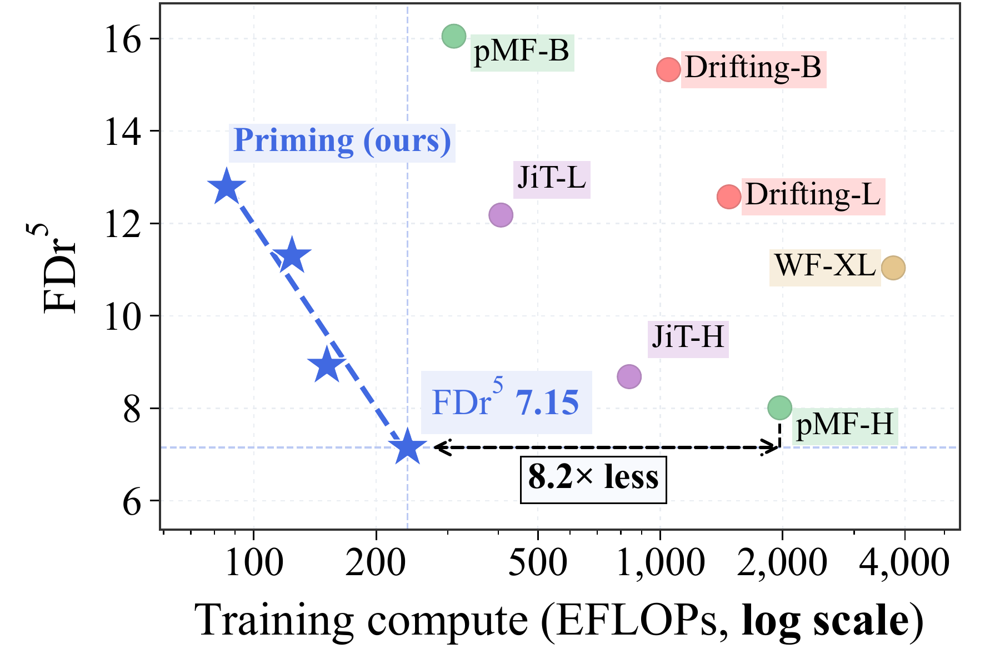

<div align="center">

<h1>Are We Overthinking One-Step Generation?</h1>
<h2>Priming Models</h2>

<p><strong><a href="https://parkwbin.github.io/">Woobin Park</a><sup>1,*</sup>, <a href="https://jaeyeonkim01.github.io/">Jaeyeon Kim</a><sup>2,*</sup>, <a href="https://yilundu.github.io/">Yilun Du</a><sup>2</sup>, <a href="https://www.sitanchen.com/">Sitan Chen</a><sup>2</sup>, <a href="https://cv.snu.ac.kr/index.php/~bhhan/">Bohyung Han</a><sup>1</sup></strong></p>

<p><sup>1</sup> Seoul National University &nbsp;·&nbsp; <sup>2</sup> Harvard University &nbsp;·&nbsp; <sup>*</sup> Equal contribution</p>

<p id="paper-links">
  <a href="https://arxiv.org/abs/2610.20331" title="Read the arXiv preprint"></a>
  <a href="https://x.com/Jaeyeon_Kim_0/status/2110744814274674851" title="Read the X announcement"></a>
</p>

</div>

Official implementation of [Are We Overthinking One-Step Generation?](https://arxiv.org/abs/2610.20331).

[](docs/figures/figure1.pdf)

## News

- **October 17, 2026:** Faster B/L post-training recipes deliver about **3× faster
  warmed training updates** with reproduced final FID after 25,000 updates.
  **Only frozen-encoder execution changed**. The original public code
  is preserved on [paper-reproduction](https://github.com/JaeyeonKim01/priming/tree/paper-reproduction)
  and tagged [v1.0-paper](https://github.com/JaeyeonKim01/priming/tree/v1.0-paper).

  | Model | Benchmark GPUs | s/update (previous → new) | Speedup | Final FID (previous → new) | Total time (previous → new) |
  |---|---|---:|---:|---:|---:|
  | B-160 | 8 × H100 | 5.65 → 1.83 | **3.09×** | 1.3841 → **1.3837** | ~36.6h → **~13.6h** |
  | L-160 | 8 × H200 | 5.64 → 1.92 | **2.94×** | 1.1871 → **1.1810** | ~38.7h → **~13.9h** |

  FID: three-seed means, released → new checkpoints. Total time: 25k updates
  including evaluations; previous runs used 8 H200s across four nodes, new runs
  used the GPUs above across two nodes. Speedups use matched warmed-update benchmarks.

- **October 11, 2026:** Text-to-image (T2I) and world modeling code will be ready
  in two weeks, on **October 25, 2026**.

## Getting started

Clone this repository as `Priming`; all commands below start there.

```bash
git clone https://github.com/JaeyeonKim01/priming.git Priming
cd Priming
bash scripts/create_env.sh
conda activate priming
export PYTHONNOUSERSITE=1
python scripts/check_environment.py
```

- [Environment setup](docs/setup.md): pinned environment, GPU execution, and external storage.
- [Data and model assets](docs/assets.md): processed ImageNet, [encoder configurations and paths](docs/assets.md#encoder-configuration-and-paths), OT calibration, and precomputed evaluation statistics.
- [Checkpoint downloads](docs/checkpoints.md): download and verify the released models. Sampling needs only a generator checkpoint.
- [Workflow and checks](docs/validation.md): end-to-end training, startup checks, and numerical tests.

ImageNet pretraining and post-training require **eight GPUs** and approximately
**259 GB** for the prepared dataset, plus model assets and training outputs.
B training has been checked on H100 80 GB; use H200s for L post-training.
Accept the ImageNet dataset terms and prepare the assets before launching.
Follow the [two-update training check](docs/validation.md#check-the-training-setup-before-a-full-run)
to test pretraining → your saved checkpoint → post-training on your setup.

## Checkpoints

Four model/epoch combinations, each available before and after post-training.
Epochs refer to reconstruction pretraining; post-training adds 25,000 OT updates.

| Model | Pretraining epochs | Pretrained | Post-trained |
|---|---:|---|---|
| Priming-B | 80 | [View checkpoint](https://huggingface.co/jaykim1102/priming/blob/main/checkpoints/pretraining/priming_b_80.pth) | [View checkpoint](https://huggingface.co/jaykim1102/priming/blob/main/checkpoints/priming_b_80.pth) |
| Priming-B | 160 | [View checkpoint](https://huggingface.co/jaykim1102/priming/blob/main/checkpoints/pretraining/priming_b_160.pth) | [View checkpoint](https://huggingface.co/jaykim1102/priming/blob/main/checkpoints/priming_b_160.pth) |
| Priming-L | 80 | [View checkpoint](https://huggingface.co/jaykim1102/priming/blob/main/checkpoints/pretraining/priming_l_80.pth) | [View checkpoint](https://huggingface.co/jaykim1102/priming/blob/main/checkpoints/priming_l_80.pth) |
| Priming-L | 160 | [View checkpoint](https://huggingface.co/jaykim1102/priming/blob/main/checkpoints/pretraining/priming_l_160.pth) | [View checkpoint](https://huggingface.co/jaykim1102/priming/blob/main/checkpoints/priming_l_160.pth) |

All eight files are hosted at [jaykim1102/priming](https://huggingface.co/jaykim1102/priming).
See the [download guide](docs/checkpoints.md) and the [checked-in manifests](old/checkpoints).
Pretraining checkpoints contain online and EMA weights; post-training initializes
from online weights, and final evaluation uses post-training EMA 0.999.

<details>
<summary><strong>Sampling from our models</strong></summary>

[](docs/figures/figure2.pdf)

Download one checkpoint and generate samples on a single GPU:

```bash
hf auth login
hf download jaykim1102/priming checkpoints/priming_b_160.pth --local-dir .
python scripts/sample.py --model priming_b_160 --num-images 16 \
  --class-ids 207 --output-dir outputs/samples/b160
```

Saves individual PNGs and a `samples.json` record. `--class-ids` accepts ImageNet
IDs 0–999; omit it to cycle through classes. B/L and 80/160 checkpoints are
supported. Use `--stage pretraining` for pretrained weights after downloading
the corresponding file under `checkpoints/pretraining/`.
See [sampling options](docs/checkpoints.md#sampling-options).

</details>

<details>
<summary><strong>Evaluation: ImageNet</strong></summary>

Evaluate the four released Priming models with **FID** and **FDr⁵**. Download the
selected generator checkpoint first, as above, then prepare the evaluation
encoders and precomputed reference statistics. No ImageNet images are needed.
Start with a 1,000-image pilot on four GPUs:

```bash
python scripts/download_assets.py --group evaluation
torchrun --standalone --nproc_per_node=4 eval.py \
  --model priming_b_160 --num-images 1000 --seeds 1 --batch 32 \
  --output-dir outputs/eval/pilot_b160
```

For the paper protocol, use `--num-images 50000 --seeds 1 2 3` and a new output
directory. Preserve four ranks and batch 32: changing either changes the sample
stream. Official FID uses FP32 Inception on rounded uint8 images and the JiT
reference; FDr⁵ uses five frozen encoders on float images, excluding ConvNeXt.

[Evaluation guide and options](docs/eval.md)

<details>
<summary><strong>ImageNet evaluation results</strong></summary>

Each row is the mean over three sampling seeds of one checkpoint,
with 50,000 images per seed; these are not independent training runs.

<table>
<tr>
<td valign="top">
<table>
<tr><th>Model</th><th>FID ↓</th><th>FDr⁵ ↓</th></tr>
<tr><td>Priming-B-80</td><td>1.4683</td><td>12.7089</td></tr>
<tr><td>Priming-B-160</td><td>1.3841</td><td>11.2286</td></tr>
<tr><td>Priming-L-80</td><td>1.2695</td><td>8.9430</td></tr>
<tr><td>Priming-L-160</td><td>1.1871</td><td>7.1048</td></tr>
</table>
</td>
<td valign="top">
<a href="docs/figures/figure1_fdr5.pdf"></a>
</td>
</tr>
</table>

These results use released post-training checkpoints.

</details>

</details>

## Experiment scope

This release covers ImageNet-256: B/L sampling at 80/160 pretraining epochs,
three reconstruction recipes, B/L-160 OT post-training, and B-160 SIM,
Laplacian MMD, and energy ablations. Text-to-image and world modeling code will
be ready in two weeks (October 25, 2026); see [News](#news). Comparison-baseline
samplers and the old dashboard remain available in the previous Git revision.

Post-training initializes from released pretrained online weights with a fresh
optimizer and inherits the pretrained EMA shadow. Use `--init-checkpoint PATH`
for your own compatible perceptual pretraining weights. Evaluate a terminal
post-training checkpoint with `eval.py --checkpoint PATH`, or select
`--stage pretraining` / `--weights online` for the additional evaluation modes.
The paper results above use post-training EMA 0.999.

Use eight H200 GPUs for L post-training. The original L runs exceeded
85 GiB allocated per GPU, above H100 80 GB capacity.

## ImageNet experiments

<details>
<summary><strong>Click to expand ImageNet pretraining and post-training</strong></summary>

### Training 1: Reconstruction pretraining

Train at fixed corruption t=0.8 with adaptive pixel MSE, optionally adding
LPIPS and ConvNeXt perceptual losses. Recipes cover **B with/without perceptual
loss** and **L with perceptual loss**, using Muon and EMA 0.9999. The 160-epoch
runs retain both 80- and 160-epoch checkpoints.

```bash
python pretrain.py --config configs/pretrain/b160_perceptual.yaml --check-config
torchrun --standalone --nproc_per_node=8 pretrain.py \
  --config configs/pretrain/b160_perceptual.yaml --output outputs/pretrain/b160
```

[Pretraining guide](docs/pretrain.md) ·
[Production configs](configs/pretrain) · [Source code](pretrain.py)

### Training 2: Distributional post-training

Apply feature-wise optimal transport in ResNet-MAE and ConvNeXt feature spaces.
The **B/L-160** workflows run 25,000 AdamW updates with EMA 0.999. Scheduled
online/EMA evaluations use FDr⁶, Inception Score, and precision/recall; use the
standalone evaluator above for official final FID/FDr⁵.

```bash
torchrun --standalone --nproc_per_node=8 posttrain.py \
  --config configs/posttrain/b160_fast.yaml --output outputs/posttrain/b160
```

[Post-training and resume guide](docs/posttrain.md) ·
[Production configs](configs/posttrain) · [Source code](posttrain.py)

- **Ablation study 1: SIM feature-space training.** Use SigLIP, Inception, and ViT-MAE features with [b160_sim.yaml](configs/posttrain/b160_sim.yaml).
- **Ablation study 2: Other distributional losses.** Replace OT with [Laplacian MMD](configs/posttrain/b160_laplacian.yaml) or [energy distance](configs/posttrain/b160_energy.yaml).

Prepare the dataset and encoders using the [asset guide](docs/assets.md) before
training. Start with the [two-update training check](docs/validation.md#check-the-training-setup-before-a-full-run)
to verify pretraining → post-training on your setup. See the stage guides for
custom initialization and checkpoint recovery.

</details>

## Code layout

`pretrain.py`, `posttrain.py`, and `eval.py` share the implementations in
`models/`, `losses/`, `metrics/`, `data/`, and `utils/`. Each recipe inherits the
`_base.yaml` beside it. The matcher receives generated and real samples and
returns a loss; the training loop owns sampling, optimizer updates, and recovery.

Dependency pins, asset manifests, and released inference configurations live
under [`old/`](old/README.md) and are still required by the active tools.
Downloaded generator weights retain their published `checkpoints/` paths.

See [validation instructions](docs/validation.md) to run the numerical comparison
suite against a checkout of the previous implementation.

## License

Copyright 2026 the Priming contributors.

The original code in this repository is licensed under the
[Apache License 2.0](LICENSE).
Third-party code retains its original license and copyright notices, including
[W-Flow (MIT)](models/encoders/full/LICENSE-W-Flow) and
[torch-fidelity (Apache-2.0)](models/encoders/LICENSE-torch-fidelity.md).
External datasets, model weights, and other downloaded assets remain subject to
their respective licenses and terms.

## Citation

If you use Priming in your research, please cite:

```bibtex
@misc{park2026are,
  title   = {Are We Overthinking One-Step Generation?},
  author  = {Park, Woobin and Kim, Jaeyeon and Du, Yilun and Chen, Sitan and Han, Bohyung},
  year    = {2026},
  eprint  = {2610.20331},
  archivePrefix = {arXiv},
  primaryClass = {cs.LG},
  url     = {https://arxiv.org/abs/2610.20331}
}
```
